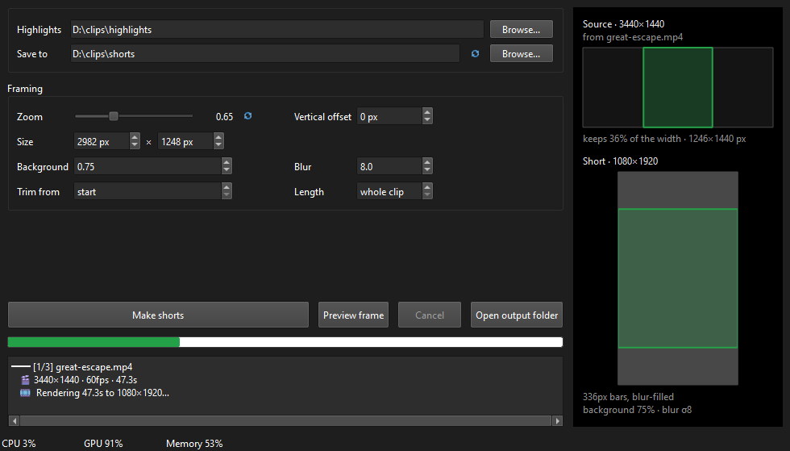

<div align="center">
  

  **Turns landscape clips into uploads.**
</div>

# VVideo — landscape to vertical video converter for YouTube Shorts, TikTok and Reels

VVideo is a free, open-source **9:16 vertical video converter for Windows**. It
reframes a landscape highlight as a **1080×1920 Short** — the footage centred at
a fraction of the frame height, the bars above and below filled with a blurred,
darkened copy of the same frame — without opening a video editor.

Batch-convert a whole folder of gameplay clips, stream highlights or screen
recordings to portrait in one ffmpeg pass, GPU-accelerated with **NVENC**. Comes
as a **Qt desktop app** and a **command-line tool**, plus a portable `.exe` that
needs no Python installed.



---

## Features

- **Landscape → portrait (9:16)** at 1080×1920, the native size for YouTube
  Shorts, TikTok, Instagram Reels and Facebook Reels.
- **Blurred background fill** — no black bars. The same frame, scaled to cover,
  blurred and darkened behind the clip.
- **Batch processing.** Point it at a folder; every video in it is converted,
  each keeping its own name.
- **GPU-accelerated encoding** with NVIDIA NVENC (`h264_nvenc`), falling back to
  libx264 on machines without one.
- **Live framing diagram** that draws the crop to scale as you change it, and a
  **single-frame PNG preview** rendered from the real footage.
- **Zoom in pixels or as a factor** — drag the bar, or type the exact scaled
  size when it has to match something.
- **Trim** a start point and a length without a separate pass.
- **Cancel mid-run**, killing the ffmpeg in flight rather than leaving it
  encoding in the background.
- **CPU, GPU and memory readouts** along the bottom, so you can see whether the
  render landed on the GPU.
- **Settings remembered** between launches, with a one-click reset on every
  input.
- **One portable `.exe`** — no Python, no ffmpeg install, nothing on `PATH`.

Input formats: `.mp4`, `.mkv`, `.mov`, `.avi`, `.webm`, `.flv`, `.m4v`, `.ts`.
Output: H.264 MP4 with AAC audio at 192 kbps.

---

## What it does

Point it at a folder of clips. Every video in it is reframed and written to the
output folder, each keeping its own name.

```
+----------------+  <- blurred cover of the frame, at 75% opacity
|################|
+----------------+
|     source     |  <- the clip at 1920 * zoom tall, centre-cropped
+----------------+
|################|
+----------------+
```

This replaces doing it by hand in DaVinci Resolve — clip on a portrait timeline
at zoom 0.5 plus a Blanking Fill at 75% background opacity — in one ffmpeg pass,
at roughly 7× realtime on NVENC.

---

## Getting started

### Run the app

```
python -m venv .venv
.venv\Scripts\activate
pip install -r requirements.txt
python VVideo.py
```

ffmpeg ships inside the `imageio-ffmpeg` wheel — nothing else to install, and
nothing needs to be on `PATH`.

### Build the .exe

```
pyinstaller VVideo.spec      # -> dist\VVideo.exe
```

One self-contained ~130 MB executable, no Python needed on the target machine.

---

## Built with

Python 3.12. Everything below installs from `requirements.txt`, which holds the
version floors; the versions in brackets are what it is developed against.

| Library | What it does here |
|---|---|
| **[OpenCV](https://opencv.org/)** (`opencv-python`, 5.0) | Probes each source for resolution, fps and duration — imageio-ffmpeg ships ffmpeg only, with no ffprobe. |
| **[PySide6](https://doc.qt.io/qtforpython/)** (Qt 6.11) | The window. Widgets, the worker thread jobs run on, and the signals they report back through. |
| **[imageio-ffmpeg](https://github.com/imageio/imageio-ffmpeg)** (0.6) | Ships **ffmpeg 7.1** inside the wheel. Nothing needs installing or adding to `PATH`, and the binary rides along into the `.exe`. |
| **[PyInstaller](https://pyinstaller.org/)** (6.21) | Build only: freezes everything above into `dist\VVideo.exe`. |

Every ffmpeg invocation is a plain `subprocess` call with hand-written argument
lists — deliberately, no wrapper library.

---

## Using the window

The window takes a **folder of videos** and an output folder, and reframes every
video in the folder in turn. (A single file path typed into the field works too.)
Everything lands in the one output folder, which defaults to
`%USERPROFILE%\Videos\VVideo`.

Zoom, vertical offset, background opacity, blur and a trim are all on the page.

**Zoom** is a drag bar with the factor beside it, and **Size** underneath is the
same setting in pixels — the width and height the clip is scaled to before it is
cropped to the canvas. Drag when you are eyeing it against the diagram; type a
pixel size when it has to match something. Either box settles the other from the
source's aspect, and both move the bar, so a size the bar cannot reach comes
back corrected rather than sticking. Because the width is the source's aspect
applied to the height, the numbers change when a folder with a different
resolution is picked.

The panel down the right side draws the framing to scale and redraws as you
change it. On top, the source frame with the region that survives the crop
picked out — so *how much am I throwing away* is answered before a frame is
decoded. Below, the 1080×1920 result: the foreground where the offset puts it,
and the blur-filled bars above and below, shaded by the background opacity. The
source dimensions come from the first video in the chosen folder; until there is
one, the diagram says which resolution it is assuming.

That is geometry, not a render. **Preview frame** is the other half: it
composites a single real frame to a PNG and shows it, which is the cheap way to
settle the zoom against actual footage before rendering anything.

Every input with a default has a ↺ button that appears when you change it and
puts it back. Size has none of its own — it is zoom said differently, so zoom's
resets both. Folders and framing settings are remembered between launches.

Work runs on a background thread, so the window stays responsive, and **Cancel**
stops a run at any point — killing the ffmpeg it has in flight, not just
abandoning it. Closing the window mid-job asks first, then does the same.
**Open output folder** puts the results up in Explorer without going looking for
the path.

Progress is one bar across the whole run: with three videos, the first finishing
puts you at 33%.

Along the bottom, **CPU**, **GPU** and **Memory** refresh twice a second — the
quick way to tell whether the render is landing on NVENC or falling back to
x264. Hovering gives the card's name and the used/total figures. The GPU reading
needs an NVIDIA driver; without one it reads `--`, as CPU and memory do off
Windows.

---

## Command line

The same job, one file at a time, with a few extras the window has no room for.

```
python make-short.py clip.mp4
python make-short.py clip.mp4 --preview             # one PNG frame, encode nothing
python make-short.py clip.mp4 --preview 12.5        # ...at a specific second
python make-short.py clip.mp4 --start 12 --duration 45
python make-short.py clip.mp4 --zoom 0.6 --offset-y -80
python make-short.py clip.mp4 --out D:\shorts
```

Without `--out`, `make-short.py` writes to `export/shorts/`.

Renders are NVENC when the GPU takes it (`h264_nvenc`, preset p5, VBR at
`-cq 19`), libx264 at `-crf 18` otherwise; audio to AAC at 192 kbps. Which
encoder is used is settled by actually trying `h264_nvenc` on the machine —
ffmpeg carries it whether or not there is a card to run it on.

---

## How it works

### The filtergraph

One `filter_complex`, one decode. `split` feeds two branches: the background is
the frame scaled to *cover* 1080×1920, centre-cropped, blurred and darkened; the
foreground is the frame scaled to `1920 * zoom` tall and cropped to the canvas.
`overlay` puts one on the other.

The blur runs on a 1/8-size copy and is scaled back up, so the effective
full-resolution sigma is 8× what the config says. A real sigma-64 gaussian over a
1080×1920 plane is the slowest filter in the graph by a wide margin and looks no
different — past a certain radius the upscale interpolation *is* the blur.

Background opacity is a straight multiply toward black (`colorlevels`), which is
what compositing at that alpha over the timeline's black backdrop comes to.

### Zoom means fill

Zoom means what Resolve's Inspector means by it, with **1.0 being *fill*** — the
clip scaled until it covers the portrait frame, sides cropped off — not fit. The
scale factor is `1920 / source_height`, and two things follow:

- The foreground is always `1920 * zoom` tall and the bars are always
  `1920 * (1 - zoom) / 2` each, **whatever the source aspect**. Blanking is
  therefore always top and bottom, never left and right. At zoom ≥ 1 there are
  none and the blurred background never shows.
- How much of the source's **width** survives the crop does depend on the aspect:
  a 3440×1440 (21:9) clip keeps its central ~47% at zoom 0.5, a 1920×1080 one
  ~63%. The app prints the figure it computed.

`src/shorts.py` exposes that arithmetic on its own — `scaled_size()`,
`zoom_for_height()` and `zoom_for_width()` — which is what lets the window show
the scaled size in pixels, and accept one typed in, without planning a render.

---

## Configuration

Everything tunable lives in `config/shorts.json`: canvas size, zoom, vertical
offset, background opacity, blur sigma and downscale, Blanking Fill crop insets.
Geometry is computed from the source at runtime, so nothing here is tied to a
resolution; every CLI flag just overrides the matching key.

---

## Project layout

```
VVideo.py            entry point for the window, and what PyInstaller freezes
VVideo.spec          the .exe build
make-short.py        CLI: landscape clip -> 1080x1920 short
src/
  pipeline.py        the seam every front end calls through
  gui.py             the window
  shorts.py          portrait geometry and the filtergraph
  video_io.py        probing, and every ffmpeg invocation
  sysmon.py          CPU/GPU/memory counters behind the status bar
  config.py          config/ loading, also from inside the frozen bundle
config/              shorts.json
```

`src/pipeline.py` is the seam: it takes `log` and `progress` callbacks rather
than printing, so the window and the CLI are both thin front ends over the same
code.

---

## FAQ

### How do I convert a landscape video to vertical without black bars?

Use a blurred copy of the frame as the background instead of black. That is what
VVideo does by default: the clip sits at zoom 0.5 and the bars above and below
are filled with the same frame, scaled to cover, blurred, and darkened to 75%.

### Can it convert a whole folder at once?

Yes. The input field takes a folder, and every supported video inside it is
converted in turn into the one output folder, each keeping its own filename. A
single file path works too.

### Does it need ffmpeg installed?

No. ffmpeg 7.1 rides along inside the `imageio-ffmpeg` wheel, and into the
`.exe`. Nothing has to be installed or added to `PATH`.

### Does it use the GPU?

On an NVIDIA card, yes — `h264_nvenc`, at roughly 7× realtime. Without one it
falls back to libx264 on the CPU. The status bar shows which one is working.

### What source resolutions does it accept?

Any. The geometry is computed from each source at runtime, so 1920×1080,
2560×1440, 3440×1440 ultrawide and 4K all work; only how much of the *width*
survives the crop changes.

### Does it run on macOS or Linux?

Nothing in the pipeline is deliberately platform-locked, but paths, the `.exe`
build and the NVENC choice all assume Windows, and that is where it is tested.

---

## Notes

- **Windows-first.** Paths, the `.exe` build and the NVENC encoder choice all
  assume it, though nothing in the pipeline is deliberately platform-locked.

---

## License

MIT — see [LICENSE](LICENSE).

---

<sub>Keywords: landscape to vertical video converter, 16:9 to 9:16, YouTube
Shorts maker, TikTok video converter, Instagram Reels converter, batch video
converter, blurred background video, 1080x1920 portrait video, ffmpeg NVENC GPU
encoding, Python PySide6 Qt desktop app, Windows video tool, DaVinci Resolve
Blanking Fill alternative, open source.</sub>
