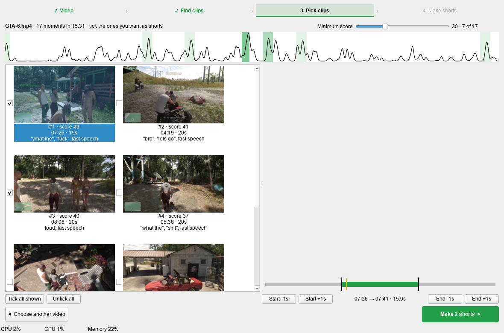

<div align="center">
  

  **Turns a long gameplay recording into ready-to-post shorts.**
</div>

# VVideo — automatic gameplay clips for YouTube Shorts, TikTok and Reels

VVideo is a free, open-source **auto-clipper for Windows**. Give it a long
gameplay recording; it listens to the whole thing, finds the best moments, lets
you pick the ones you want, and writes each one as a **1080×1920 vertical
short** — the footage centred, the bars above and below filled with a blurred,
darkened copy of the same frame. No video editor, no cloud, nothing uploaded.



---

## Four steps

The window walks you through them; each step moves on by itself.

1. **Video** — choose (or drop) a recording. If OBS put your microphone on its
   own audio track, say which one: reactions are then found in your voice rather
   than in the game's dialogue.
2. **Find clips** — VVideo analyses the sound: loudness, shouts and laughter,
   gunfire and explosions, fast speech and trigger phrases ("no way", "não
   acredito"...). A progress bar and a short log show where it is. **Cancel**
   goes back to step 1.
3. **Pick clips** — every moment is a card with a frame, a score and why it was
   picked; the hype curve shows the whole recording. Click a card to loop it,
   drag the ends of the bar (or ±1 s) to trim it, tick the ones you want and
   press **Make shorts**. **Minimum score** hides the weaker ones.
4. **Make shorts** — a preview of a picked clip already in vertical.
   **Adjust framing...** changes zoom, vertical position, background and blur,
   and the preview follows. Choose where to save, press **Generate**, and each
   clip is cut and reframed in one encode. **Open folder** shows them; **New
   video** starts again; **Back** returns to the clips without losing anything.

Output: H.264 MP4, 1080×1920, AAC audio at 192 kbps, one file per clip named
after the recording and the clip's start (`session_07m26s.mp4`).
Input formats: `.mp4`, `.mkv`, `.mov`, `.avi`, `.webm`, `.flv`, `.m4v`, `.ts`.

- **GPU-accelerated** with NVIDIA NVENC, falling back to libx264 without one;
  Whisper runs on the GPU too.
- **Exact cuts** — the clip is re-encoded anyway, so it starts on the frame you chose.
- **Cancel any time**, killing the ffmpeg in flight.
- **CPU, GPU and memory readouts** along the bottom.
- **One portable `.exe`** — no Python, no ffmpeg install, nothing on `PATH`, and
  nothing left in the registry or `AppData` when you delete it.

---

## Getting started

### Run the app

```
python -m venv .venv
.venv\Scripts\activate
pip install -r requirements.txt
pip install -r requirements-cuda.txt   # optional: Whisper on an NVIDIA GPU
python VVideo.py
```

ffmpeg ships inside the `imageio-ffmpeg` wheel — nothing else to install, and
nothing needs to be on `PATH`.

### Build the .exe

```
pyinstaller VVideo.spec      # -> publish\VVideo.exe
```

A ~600 MB folder (`VVideo.exe` plus its libraries), no Python needed on the
target machine. The AI models are not bundled: they download on first use into
`VVideo-data\` beside the `.exe` (see [Where things are kept](#where-things-are-kept)).

### Tests

```
python -m pytest -q
```

---

## Built with

Python 3.12. Everything below installs from `requirements.txt`, which holds the
version floors; the versions in brackets are what it is developed against.

| Library | What it does here |
|---|---|
| **[OpenCV](https://opencv.org/)** (`opencv-python`, 5.0) | Probes each source for resolution, fps and duration — imageio-ffmpeg ships ffmpeg only, with no ffprobe. |
| **[PySide6](https://doc.qt.io/qtforpython/)** (Qt 6.11) | The window. Widgets, the worker thread jobs run on, and the signals they report back through. |
| **[imageio-ffmpeg](https://github.com/imageio/imageio-ffmpeg)** (0.6) | Ships **ffmpeg 7.1** inside the wheel. Nothing needs installing or adding to `PATH`, and the binary rides along into the `.exe`. |
| **[faster-whisper](https://github.com/SYSTRAN/faster-whisper)** (1.2) | Moments: transcribes your voice with word timestamps (large-v3-turbo on an NVIDIA GPU, small on the CPU). |
| **[sherpa-onnx](https://github.com/k2-fsa/sherpa-onnx)** (2.0) | Moments: runs CED-mini, a 10 MB AudioSet model that hears shouts, laughter, gunfire and explosions. |
| **[PyInstaller](https://pyinstaller.org/)** (6.22) | Build only: freezes everything above into `publish\`. |

Every ffmpeg invocation is a plain `subprocess` call with hand-written argument
lists — deliberately, no wrapper library.

---

## Where things are kept

Nothing is written outside the folder you save to. Preferences live in a
`VVideo.ini` beside the executable — no registry keys, nothing under `AppData` —
and only settings you actually changed go in it. Models and the analysis cache
live in `VVideo-data\`, also beside the executable; a recording analysed before
opens instantly. Delete both and the machine is back to never having run VVideo.

The first analysis downloads the sound model (45 MB), Whisper large-v3-turbo
(1.6 GB) and, in the `.exe` on a machine with an NVIDIA GPU, the CUDA libraries
Whisper needs (1.3 GB). Without an NVIDIA GPU it uses Whisper small on the CPU.
A 30-minute recording takes under a minute on an RTX 4080.

The score combines, second by second: how much louder than usual the audio is,
shouts and laughter, bursts of gunfire and explosions above the usual level,
fast speech, and trigger phrases in English, Italian and Portuguese. Peaks of
that curve become 10–30 s moments with a few seconds of build-up before them.

---

## Command line

Converting clips you already have to vertical, one file at a time (the old
"Make shorts" tab):

```
python make-short.py clip.mp4
python make-short.py clip.mp4 --preview             # one PNG frame, encode nothing
python make-short.py clip.mp4 --preview 12.5        # ...at a specific second
python make-short.py clip.mp4 --start 12 --duration 45
python make-short.py clip.mp4 --zoom 0.6 --offset-y -80
python make-short.py clip.mp4 --out D:\shorts
```

Without `--out`, `make-short.py` writes to `export/shorts/`.

The Moments analysis on its own, printing a table of moments:

```
python find-moments.py recording.mkv
python find-moments.py recording.mkv --min-score 50 --json moments.json
python find-moments.py recording.mkv --voice-track 1
```

Renders are NVENC when the GPU takes it (`h264_nvenc`, preset p5, VBR at
`-cq 19`), libx264 at `-crf 18` otherwise; audio to AAC at 192 kbps. Which
encoder is used is settled by actually trying `h264_nvenc` on the machine —
ffmpeg carries it whether or not there is a card to run it on.

---

## How it works

### The filtergraph

One `filter_complex`, one decode. `split` feeds two branches: the background is
the frame scaled to *cover* 1080×1920, centre-cropped, blurred and darkened; the
foreground is the frame scaled to `1920 * zoom` tall and cropped to the canvas.
`overlay` puts one on the other.

The blur runs on a 1/8-size copy and is scaled back up, so the effective
full-resolution sigma is 8× what the config says. A real sigma-64 gaussian over a
1080×1920 plane is the slowest filter in the graph by a wide margin and looks no
different — past a certain radius the upscale interpolation *is* the blur.

Background opacity is a straight multiply toward black (`colorlevels`), which is
what compositing at that alpha over the timeline's black backdrop comes to.

### Zoom means fill

Zoom means what Resolve's Inspector means by it, with **1.0 being *fill*** — the
clip scaled until it covers the portrait frame, sides cropped off — not fit. The
scale factor is `1920 / source_height`, and two things follow:

- The foreground is always `1920 * zoom` tall and the bars are always
  `1920 * (1 - zoom) / 2` each, **whatever the source aspect**. Blanking is
  therefore always top and bottom, never left and right. At zoom ≥ 1 there are
  none and the blurred background never shows.
- How much of the source's **width** survives the crop does depend on the aspect:
  a 3440×1440 (21:9) clip keeps its central ~47% at zoom 0.5, a 1920×1080 one
  ~63%. The app prints the figure it computed.

`src/shorts.py` exposes that arithmetic on its own — `scaled_size()`,
`zoom_for_height()` and `zoom_for_width()` — which is what lets the window show
the scaled size in pixels, and accept one typed in, without planning a render.

---

## Configuration

Everything tunable lives in `config/shorts.json`: canvas size, zoom, vertical
offset, background opacity, blur sigma and downscale, Blanking Fill crop insets.
Geometry is computed from the source at runtime, so nothing here is tied to a
resolution; every CLI flag just overrides the matching key.

`config/moments.json` holds the Moments tuning: moment length, the weight of each
signal, and the trigger phrases per language.

---

## Project layout

```
VVideo.py            entry point for the window, and what PyInstaller freezes
VVideo.spec          the .exe build
make-short.py        CLI: landscape clip -> 1080x1920 short
find-moments.py      CLI: recording -> table of its best moments
src/
  pipeline.py        the seam every front end calls through
  gui.py             the window
  steps.py           the four steps of the window
  moments/           audio, sound events, speech, signals, and the engine that scores them
  evaluation/        developer tooling: evaluation set, metrics, reports (docs/ai-highlights/)
  shorts.py          portrait geometry and the filtergraph
  video_io.py        probing, and every ffmpeg invocation
  sysmon.py          CPU/GPU/memory counters behind the status bar
  config.py          config/ loading, also from inside the frozen bundle
config/              shorts.json, moments.json
eval/                labelled recordings and the frozen baseline (labels only, no video)
tools/evaluate.py    developer tool: score the detector (--gui opens the labelling window)
tests/               python -m pytest -q
```

`src/pipeline.py` is the seam: it takes `log` and `progress` callbacks rather
than printing, so the window and the CLI are both thin front ends over the same
code.

---

## FAQ

### How do I convert a landscape video to vertical without black bars?

Use a blurred copy of the frame as the background instead of black. That is what
VVideo does by default: the clip sits at zoom 0.5 and the bars above and below
are filled with the same frame, scaled to cover, blurred, and darkened to 75%.

### Can it convert clips I already cut?

Not from the window, which starts from a full recording. `make-short.py` converts
an existing clip to vertical from the command line (see [Command line](#command-line)).

### How does it decide what a "best moment" is?

From the sound only, for now: loudness above the recording's own usual level,
shouts and laughter, gunfire and explosions, fast speech and trigger phrases.
With one mixed audio track it cannot tell your voice from the game's dialogue,
so a separate microphone track gives better picks.

### Does it need ffmpeg installed?

No. ffmpeg 7.1 rides along inside the `imageio-ffmpeg` wheel, and into the
`.exe`. Nothing has to be installed or added to `PATH`.

### Does it use the GPU?

On an NVIDIA card, yes — `h264_nvenc`, at roughly 7× realtime. Without one it
falls back to libx264 on the CPU. The status bar shows which one is working.

### What source resolutions does it accept?

Any. The geometry is computed from each source at runtime, so 1920×1080,
2560×1440, 3440×1440 ultrawide and 4K all work; only how much of the *width*
survives the crop changes.

### Does it run on macOS or Linux?

Nothing in the pipeline is deliberately platform-locked, but paths, the `.exe`
build and the NVENC choice all assume Windows, and that is where it is tested.

---

## Notes

- **Windows-first.** Paths, the `.exe` build and the NVENC encoder choice all
  assume it, though nothing in the pipeline is deliberately platform-locked.

---

## License

MIT — see [LICENSE](LICENSE).

---

<sub>Keywords: landscape to vertical video converter, 16:9 to 9:16, YouTube
Shorts maker, TikTok video converter, Instagram Reels converter, batch video
converter, blurred background video, 1080x1920 portrait video, ffmpeg NVENC GPU
encoding, Python PySide6 Qt desktop app, Windows video tool, DaVinci Resolve
Blanking Fill alternative, open source.</sub>
