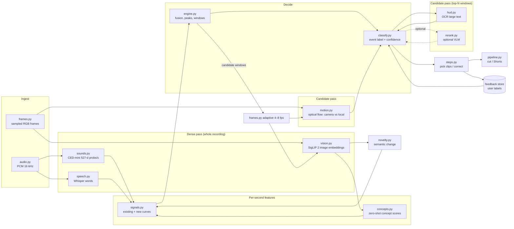
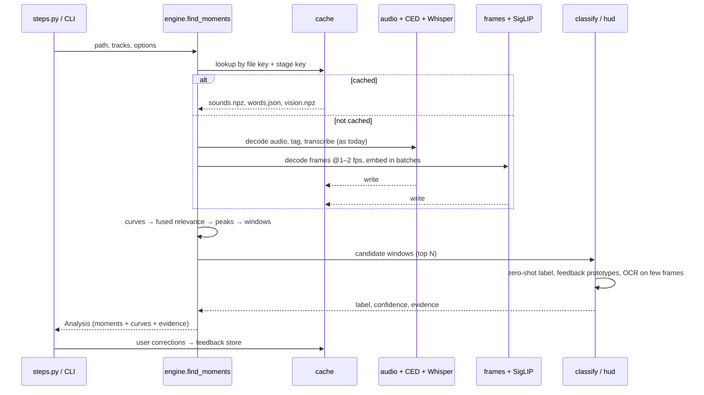
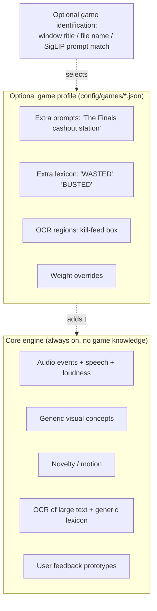

# Architecture — multimodal AI Gaming Highlights

Proposal. Builds on the existing Moments engine rather than replacing it. See
[README.md](README.md) for the conventions **[Verified] / [Secondary] / [Assumption]**.

---

## 1. Starting point (verified in the repository)

| Area | Today | File |
|---|---|---|
| Audio load | ffmpeg → 16 kHz mono float32 via pipe | `src/moments/audio.py` |
| Sound events | CED-mini (int8 ONNX, sherpa-onnx, **CPU**), 2 s windows every 1 s, top-50 labels, reduced to two groups (`reaction`, `action`) | `src/moments/sounds.py` |
| Speech | faster-whisper, large-v3-turbo fp16 on CUDA / small int8 on CPU, word timestamps, VAD; language limited to en/it/pt | `src/moments/speech.py` |
| Signals | per-second curves in [0, 1]: loudness, reaction, action, speech, keywords; rolling-median baselines | `src/moments/signals.py` |
| Fusion | weighted sum + agreement bonus + Gaussian smoothing → peaks → 10–30 s windows → word snapping → greedy overlap removal | `src/moments/engine.py` |
| Cache | `VVideo-data/cache/<sha1(path,size,mtime,tracks)>/sounds.json, words.json` | `engine._cache_dir` |
| Models | download + SHA-256 check; CUDA wheels (cuBLAS 12, cuDNN 9, NVRTC) unpacked into `VVideo-data/cuda` for the frozen build | `src/moments/models.py` |
| Video | probe (OpenCV), keyframes from packets, stream-copy cut, single thumbnail per moment, NVENC render | `src/video_io.py`, `src/pipeline.py` |
| UI | four-step window (video → find clips → pick clips → make shorts); step 3 has hype curve, cards, looping player, range bar, min-score filter | `src/gui.py`, `src/steps.py` |
| Visual analysis | **none** — no frame is decoded for analysis | — |

What the engine lacks for this project: a frame stream, a visual model, an event label per
moment, evidence beyond a list of strings, and any feedback loop.

---

## 2. Design principles

1. **Additive.** New analysers produce *more per-second curves* and *more evidence*. The existing
   peak/window/overlap logic keeps working unchanged; with vision disabled the output is identical to today's.
2. **Two-pass analysis.** A cheap dense pass over the whole recording (audio, 1–2 fps image
   embeddings), then an expensive pass only around candidate windows (OCR, higher resolution, optional VLM).
3. **Relevance ≠ label.** A moment has a *relevance score* (is it worth watching?) and,
   separately, an *event label with confidence* (what is it?). A moment may be relevant and unlabelled.
4. **Relative, not absolute.** Every learned/zero-shot score is compared to the recording's
   own baseline (rolling median), the way `signals.action` already is. This is what makes scores
   transferable across games with different art styles.
5. **Model-agnostic seams.** Encoders sit behind small interfaces (`ImageEncoder`, `SoundTagger`,
   `TextRecognizer`), keyed in the cache by model id + version.
6. **Optional everything.** No GPU → CPU path. No vision model downloaded → audio-only, as today.
   Game profiles are plain JSON files that only *add* prompts, lexicon entries or OCR regions.

---

## 3. Components



| Module (proposed) | Responsibility | Depends on |
|---|---|---|
| `src/moments/frames.py` | Two samplers over ffmpeg pipes: **dense** (1–2 fps, whole file, or keyframes only) and **adaptive** (4–8 fps, only inside candidate windows, seek per window); downscaled; yields `(t, ndarray)` batches; CPU or NVDEC chosen by benchmark, not assumed | `video_io` |
| `src/moments/vision.py` | Load the image encoder (ONNX Runtime), numpy preprocessing matching the checkpoint's processor, batch inference, L2-normalised embeddings, float16 cache; refuses a prompt bank built for a different encoder | `models`, `frames` |
| `src/moments/concepts.py` | Loads the versioned prompt bank (precomputed text embeddings + SigLIP `logit_scale`/`logit_bias`), sigmoid scores per concept per second, baseline normalisation | `vision` cache |
| `src/moments/novelty.py` | **Semantic** change: 1 − cos sim of image embeddings vs. short and long context; scene cuts. Says *what is on screen changed*, nothing about movement | `vision` cache |
| `src/moments/motion.py` | **Physical** motion from optical flow (OpenCV DIS) on adaptive-rate frames: global (camera) motion and residual local motion, with a per-recording static-HUD mask (§6.3) | `frames` |
| `src/moments/sounds.py` (extended) | Keep the 527-d probability vector per second in the cache; add groups `vehicle`, `siren`, `crash`, `explosion` split from `gunfire` | CED-mini |
| `src/moments/features.py` | Aligns everything on the 1-second grid; one `Features` table (dense arrays) per recording | all of the above |
| `src/moments/classify.py` | Event label + confidence per moment: zero-shot first, then user-feedback prototypes (kNN / logistic) | `features`, feedback store |
| `src/moments/hud.py` | Optional: OCR on a few frames per candidate; detects large central text and matches a multilingual lexicon (victory/defeat/eliminated…) | RapidOCR |
| `src/moments/rerank.py` | Optional (M7): VLM over top-N candidates → label + one-line explanation | VLM runtime |
| `src/moments/profiles.py` | Loads optional `config/games/*.json` (extra prompts, lexicon, OCR regions). Never required | — |
| `src/moments/feedback.py` | Append-only store of user decisions (`accept`, `reject`, `relabel`, edited bounds) with the feature vectors they refer to | cache |
| `src/moments/engine.py` (extended) | Adds the new curves to `curves`; fills the new `Moment` fields; orchestrates stages and progress slices | everything |

Unchanged: `audio.py`, `speech.py`, `pipeline.py`, `shorts.py`, `video_io.py` (one new
function for a raw-frame pipe), the Shorts tab.

---

## 4. Data flow



Audio and video decoding run **concurrently** (two ffmpeg processes): audio feeds CED/Whisper
while frames feed the image encoder. GPU stages run one model at a time (see PERFORMANCE_PLAN.md).

---

## 5. Event taxonomy

A two-level taxonomy. Level 1 is what the generic engine commits to; level 2 labels appear only
when the evidence supports them, otherwise the moment keeps its level-1 label.

| Level 1 | Level 2 (only when evidence supports) | Primary signals |
|---|---|---|
| `combat` | gunfight, explosion, multi-elimination*, clutch* | CED gunfire/explosion, SigLIP "gunfight/muzzle flash/explosion", OCR kill text* |
| `vehicle` | chase/pursuit, crash, escape* | CED engine/siren/skid/crash, SigLIP "car chase/driving fast", motion energy |
| `destruction` | building collapse, fire | CED explosion/breaking, SigLIP "collapsing building/fire/debris", novelty |
| `achievement` | victory, objective complete | OCR large text + lexicon, cheering, music swell, reaction |
| `failure` | death, defeat, objective failed | OCR ("eliminated", "wasted", "defeat"), desaturated/greyed frame concept, reaction |
| `reaction` | funny, shocked, rage | laughter/shout (CED), keywords/fast speech (Whisper) |
| `unusual` | physics glitch, unexpected event | visual novelty + reaction with no combat evidence |
| `unlabelled` | — | high relevance, no confident label |

`*` = requires OCR or a game profile to be reliable; never asserted from one zero-shot score.
`non_gameplay` (menu, lobby, loading screen, desktop, scoreboard) is a *suppression* concept,
not a label: it lowers relevance.

### Per-category feasibility

| Category | Available signals | How to get reliable detection | Remaining limitations |
|---|---|---|---|
| Gunfights / intense combat | CED gunfire (already used), SigLIP combat prompts, motion | Agreement of audio *and* visual over ≥ 3 s, relative to baseline | Shooters are combat-heavy: everything looks like combat. Needs *relative* intensity, not presence. |
| Explosions | CED explosion/boom, SigLIP fire/explosion, novelty spike | Audio onset + bright novel frame within ±1 s | Cutscenes and trailers also explode. |
| Multiple eliminations | Kill-feed text, hit sounds (game-specific) | OCR of kill text + count within window; game profile improves | Generic engine cannot know who killed whom. |
| Clutch | Round state, team count — HUD only | Only via game profile; otherwise inferred weakly from reactions | Not generically detectable. |
| Chases / pursuits | Engine, siren, tyre skid (AudioSet classes exist), SigLIP driving prompts, sustained high motion | Sustained (≥ 8 s) vehicle concept + motion + siren/engine | On-foot chases are hard; first-person vs third-person cameras differ. |
| Escapes | Chase followed by calm, "wanted level" UI | Explicit rule `pursuit_then_clear` (§6.4), auto-disabled if it fails on tuning data; game profile for HUD | Ambiguous with "chase ended in death" or a cutscene; may never reach usable precision generically. |
| Vehicle collisions | CED crash/skid/smash, novelty + motion spike | Audio onset + motion discontinuity | Small collisions in racing are constant. |
| Destruction | Explosion/breaking audio, debris/collapse visuals | Novelty + destruction concept, sustained | The Finals is destruction-heavy — again needs relative scoring. |
| Unexpected physics | Novelty, reaction (laugh/shout), no combat | Reaction without combat evidence + visual novelty | Mostly found through the reaction; vision alone is weak. |
| Victory / successful objective | Big central text, cheering, music, scoreboard | OCR + multilingual lexicon (+ profile) | Games that show no text; stylised fonts defeat OCR. |
| Death / defeat / failure | Death-cam, greyscale/red vignette, "eliminated" text, frustration speech | OCR + "desaturated screen" concept + reaction | Generic "death" visual cues vary a lot. |
| Funny / reactions | Laughter, shout (CED), keywords, fast speech | Existing engine — already its strength | Silent players. |
| Discovery / unusual visuals | Novelty vs recent context, scene type change (e.g. indoor → aerial) | Embedding novelty with long baseline | Many novelty spikes are map/menu changes → suppressed by `non_gameplay`. |
| Generic "interesting" | All of the above | Fused relevance, independent of label | — |

---

## 6. Temporal analysis

### 6.0 What a frame score is — and is not

A SigLIP score says how well **one still image** matches **one sentence**. It is not event
recognition. "A car chase" scoring high on a frame means *the frame looks like images captioned
that way* — a parked car on a highway can score the same as a pursuit. Events are defined over
time and often by game rules. Therefore:
- per-frame scores are **features**, never labels on their own;
- every label needs evidence that persists over time **and** agreement with another modality (or OCR);
- whether temporal video models (X-CLIP) beat pooled frame scores is an **experiment** (M3b), not an assumption.

### 6.1 Sampling: dense pass + adaptive pass

| Pass | Rate | Scope | Purpose |
|---|---|---|---|
| Dense | **1–2 fps** (default 2; keyframe-only as fast mode) | Whole recording | Embeddings → concept curves, semantic novelty, non-gameplay suppression, candidate finding |
| Adaptive | **4–8 fps** (default 6) | Candidate windows only: `[peak − 10 s, peak + 5 s]`, merged when overlapping, capped at top-N (default 40) | Optical-flow motion, finer onsets, frames for OCR and the X-CLIP experiment |

The adaptive pass seeks per window (`-ss` before `-i`, then exact trim), so its cost scales with the
number of candidates, not the recording length. 40 windows × 15 s × 6 fps = 3,600 frames per recording
regardless of duration **[Assumption: default N and window]**.

**Grid.** Everything is still aligned to the existing 1-second grid (`n = ceil(duration)`).
Dense frames are pooled per second (mean embedding, max concept score) so vision plugs into today's
`curves` dict unchanged. Adaptive-pass results are attached to the candidate, not to the global grid.

**Frame preparation.** Gameplay is often 21:9 (the sample recording is 3440×1440). The fixed-resolution
SigLIP 2 checkpoints take a square input; a centre crop would lose the HUD and half the scene. M2
compares (a) whole-frame squash, (b) squash + centre crop when aspect > 2, max-pooled. **[Assumption]**
until measured.

### 6.2 Semantic novelty ≠ motion

| Signal | Computed from | Answers | Blind to |
|---|---|---|---|
| **Semantic novelty** (`novelty.py`) | Cosine distance between image embeddings: vs previous second (short) and vs median of last 60 s (long) | "Does the screen show something *different* from before?" (new area, explosion flash, death screen, menu) | Fast motion through a visually uniform scene (a chase on one long road has low novelty) |
| **Motion** (`motion.py`) | Dense optical flow (OpenCV DIS, grayscale, ~320 px, adaptive-pass frames) | "How much and how are pixels moving?" | Meaning: a menu animation can have high motion |

They are separate curves with separate weights; neither stands in for the other.

### 6.3 Camera-motion interference

In first-person and third-person games **the camera moves all the time**: a mouse flick turns the
whole frame into large optical flow without anything happening; a third-person chase camera keeps
the car still while the world streams past. Raw flow magnitude therefore measures the *player's
camera*, not the event. Handling:

1. **Global/local split.** Fit a global similarity/affine model to the flow vectors per frame pair
   (`cv2.estimateAffinePartial2D` with RANSAC). The model = **camera motion**; the residual flow =
   **local motion** (things moving independently: vehicles, debris, characters).
2. **Static-HUD mask.** Pixels whose intensity barely changes across the dense pass are HUD/overlay;
   they are masked out so a static HUD does not dilute camera motion and an animated HUD (kill feed,
   minimap) does not read as local motion.
3. **Relative, not absolute.** Both curves are normalised against the recording's rolling median, like `signals.action`.
4. **Limited role.** Camera motion is reported (it is a real cue for "frantic" moments) but never
   triggers a label alone; local motion supports `vehicle/crash/destruction` only with audio or concept agreement.
5. **Known failure cases**: parallax-heavy scenes (affine model too simple), camera shake effects used
   by games on explosions (shows up as camera motion — which is acceptable evidence for intensity),
   motion blur and low bitrate. Accept these as noise; measure per-label impact in M3.

### 6.4 How temporal context is used

No implicit narrative assumptions. Temporal context enters only through **named, configurable rules
whose inputs are visible evidence**, each evaluated separately on the tuning set:

| Rule (example) | Inputs | Output | Guard |
|---|---|---|---|
| `sustained` | concept/audio curve ≥ θ for ≥ d seconds (per category) | segment | hysteresis: enter θ_hi, exit θ_lo |
| `onset` | audio onset or novelty spike within ±1 s of a concept rise | event start | — |
| `contrast` | mean feature in event window − mean in preceding 30–60 s | "intensity relative to context" feature | always relative to the same recording |
| `pursuit_then_clear` → `escape` | `vehicle` + `siren` sustained ≥ 10 s, followed by ≥ 8 s with siren and combat below baseline, **and** no failure evidence (OCR, death concept) in the following 10 s | upgrade `chase` → `escape` | Disabled automatically if its tune-set precision < 0.6 or it has < 10 tune-set occurrences |
| `failure_after_combat` | combat segment followed by death/defeat evidence within 5 s | `failure` label | needs OCR or failure concept, never reaction alone |

Rules **upgrade** a level-1 label to level 2; when a rule's inputs are missing or ambiguous the moment
keeps its level-1 label (or `unlabelled`). A rule that does not show measurable precision on tuning
data is switched off, not tuned until it "looks right".

### 6.5 Event bounds and duplicates

The existing `_window()` keeps defining clip bounds from the fused relevance curve. Segment overlap
supplies the label. Event start = earliest of (segment start, onset) minus the existing `setup`;
end = segment end plus `tail`. The existing greedy overlap removal stays. Added: merge adjacent
moments of the same label separated by < 5 s; drop near-duplicates whose mean embeddings have
cos sim > 0.95 *and* matching labels (repeated menus, respawn screens) **[Assumption: thresholds, tuned in M3]**.

### 6.6 Trained temporal model?

Not first. A small temporal head (1-D conv or 2-layer transformer over 30–60 per-second vectors)
is considered only after M5, if logistic heads plateau **and** there are ≥ 300 explicit labels per
target label from ≥ 10 recordings. Before that it would overfit.

---

## 7. Multimodal fusion

| Approach | Explainable | Needs data | Cost | Verdict |
|---|---|---|---|---|
| 1. Rule-based weighted fusion | Yes (every curve visible) | No | Free | **Ship first** — it is today's engine, extended |
| 2. Zero-shot multimodal classification | Mostly (prompt scores) | No | Low | **Ship first**, as additional curves and labels |
| 3. Embedding-based classification (kNN / prototypes) | Yes ("similar to moments you kept") | ≥ 5 explicit positives **and** ≥ 5 explicit rejections per label | Very low | **Second step** — learns from corrections without retraining |
| 4. Lightweight trained classifier (logistic on concatenated features) | Partly (feature weights) | ≥ 30 explicit positives and ≥ 30 explicit negatives per label, from ≥ 3 recordings | Low | Third step, per user |
| 5. Temporal transformer / sequence model | Weak | Thousands of labels | Medium | Only if 3–4 plateau |

Order: **1 + 2 → 3 → 4 → (5)**. Reason: 1 and 2 need no data and are measurable immediately;
3 turns every accept/reject in the UI into training signal at zero training cost; 4 and 5 need data we do not have.

Relevance stays a weighted fusion of curves (today's formula) with new terms:
`vision_intensity` (max relative concept score among action concepts), semantic `novelty`,
and a multiplicative `(1 − non_gameplay)` suppression. Optical-flow motion exists only for candidates
(adaptive pass), so it re-scores candidates and supports labels; it does not create candidates. Weights live in `config/moments.json` as today.

Label confidence per moment starts as an **uncalibrated label score**:
`s(label) = combine(relative concept score, audio evidence, rule outputs)` — monotonic, useful for
ranking and thresholds, but not a probability. Calibration is staged by data volume:

| Data available on the **tuning** recordings | Calibration |
|---|---|
| < 30 positives or < 30 negatives for a label | **None.** The UI shows a level (low / medium / high) from tuning-set thresholds, not a percentage |
| ≥ 30 / 30 for a label, but sparse per label overall | One **shared** calibrator (temperature / Platt with a per-label offset only) fitted across labels |
| ≥ 100 / 100 for a label | Per-label Platt scaling, kept only if it lowers ECE on the held-out set |

Calibration is fitted on the tuning split and reported on the held-out split (ECE, Brier,
reliability diagram — see DATASET_RESEARCH.md §5). Feedback prototypes adjust the score *before* calibration.

---

## 8. Data structures

Backward compatible: new fields have defaults; JSON gains a `version`.

```python
@dataclass
class Evidence:
    modality: str      # "audio" | "speech" | "vision" | "ocr" | "motion" | "feedback" | "vlm"
    signal: str        # "gunfire", "concept:car chase", "text:VICTORY", "keyword:no way"
    value: float       # 0..1 after normalisation
    at: float          # seconds, where it peaked
    detail: str = ""   # e.g. the OCR string, the matched prompt

@dataclass
class Moment:                 # existing fields unchanged
    start: float
    end: float
    peak: float
    score: int                # relevance 0..100 (as today)
    reasons: list[str]        # kept for the current UI
    label: str = "unlabelled"     # taxonomy level 1 or 2
    confidence: float = 0.0       # 0..1, calibrated
    evidence: list[Evidence] = field(default_factory=list)
    explanation: str = ""         # one line built from top evidence (or VLM)
```

`Analysis.signals` already carries every curve to the UI; vision curves are added there, so the
hype-curve widget can show them without new plumbing.

Explanation is generated deterministically from the top-3 evidence items, e.g.
*"Vehicle chase — siren and engine for 14 s, 'car chase' visual score 0.71 (baseline 0.22), you shouted."*

---

## 9. Cache strategy

Per recording, the existing key (`path | size | mtime | track | voice`) selects a folder. Inside,
each stage has its own file keyed by **stage parameters**, so changing one stage does not
invalidate the others:

| File | Key includes | Format | Size **[Assumption]** for 60 min |
|---|---|---|---|
| `sounds.json` (today) / `sounds.npz` (new: full 527-d) | CED model id | npz float16 | 3600 × 527 × 2 B ≈ 3.8 MB |
| `words.json` (today) | Whisper model | json | < 1 MB |
| `vision-<encoder-sha>-<fps>-<prep>.npz` | ONNX file SHA-256, fps, frame prep | npz float16 | 7200 × 768 × 2 B ≈ 11 MB (base) |
| `adaptive-<encoder-sha>-<fps>.npz` | as above + window list | npz | per candidate, incremental |
| `motion-<fps>.npz` | adaptive fps, flow params | npz | small, per candidate |
| `ocr-<model>.json` | OCR model, candidate times | json | small, incremental |
| `concepts-<bank-sha>.npz` | prompt-bank file SHA-256 + vision file | npz | small; recomputed in ms |

Concept scores are recomputed from cached embeddings whenever prompts change — no re-decoding.

**Prompt bank versioning.** `config/events.npz` carries, besides the embeddings: the checkpoint repo id
and **revision hash**, the SHA-256 of the image-encoder ONNX it pairs with, tokenizer id/hash,
text length and lowercasing flag, `logit_scale`/`logit_bias`, the prompt-bank JSON SHA-256 and the
export-tool version. At load time `vision.py` compares the encoder SHA-256; on mismatch the vision
stage is disabled with a clear log line rather than producing silently wrong scores. Generation is
described in MODEL_EVALUATION.md §9.
**Incremental analysis:** OCR results are cached per timestamp, so moving a moment's bounds or
adding candidates only processes new frames. Feedback lives outside per-file caches:
`VVideo-data/feedback/` (embeddings + labels), so learning survives cache deletion. Feedback and
feature vectors **never leave the machine**; there is no upload path in the design.

---

## 10. Failure handling

| Failure | Behaviour |
|---|---|
| Vision model missing / download fails | Log once, run audio-only (today's behaviour), mark analysis `vision: false` |
| ONNX Runtime CUDA provider fails to load (DLLs, driver) | Fall back to DirectML (if shipped) or CPU, log the reason — same pattern as `speech.transcribe` |
| CUDA out-of-memory | Halve batch size and retry; after 2 failures, CPU |
| Frame decode error mid-file | Keep frames decoded so far; missing seconds get NaN and are excluded from baselines |
| Video shorter than windows / no audio track | Existing guards; vision-only relevance |
| Cancel | Every stage calls `cancel.check()` per batch; ffmpeg pipes are tracked by `Canceller` (existing) |
| Corrupt cache file | Delete that stage's file only, recompute |
| OCR model missing | Skip OCR evidence; labels needing it stay at level 1 |
| Prompt bank edited by user with invalid JSON | Keep last good bank, show error |
| Prompt bank built for a different encoder (SHA-256 mismatch) | Disable vision concepts, keep embeddings/novelty, log the mismatch |
| Adaptive pass seek fails for a window | Skip that window's motion/OCR evidence; candidate keeps dense-pass evidence |

---

## 11. Game-agnostic boundary



General-purpose models are sufficient for: combat intensity, explosions, vehicles, destruction,
non-gameplay screens, reactions, novelty. Game-specific knowledge becomes necessary for: kill
attribution, death vs. knock, round/match outcome when there is no big text, objective state,
and game-specific mechanics (e.g. a cash-out in The Finals).

**Automatic game identification** is cheap (SigLIP prompt "a screenshot of <game>" over a few
frames, or OBS file naming) and useful only to auto-select a profile. It is never required; an
unknown game runs the core engine.

---

## 12. Interoperability with Shorts

Detection produces `Moment`s; rendering consumes `(start, end)` ranges. They stay separate.
Proposed bridge (M4): a "Send to Shorts" action that cuts the selected moments (existing
`pipeline.cut_moments`) into a folder and queues them for the existing `make_shorts_batch`
— no changes to `shorts.py`. A later option is rendering directly with `render(start, duration)`,
which already exists, to avoid the keyframe-aligned stream copy.
