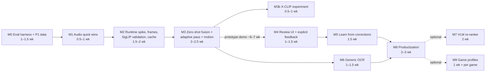

# Implementation plan

One developer, full time. Estimates are **[Assumption]** and include tests and docs.
Prototype milestones (P) prove value quickly and may cut corners in UI and packaging;
production milestones (M-prod) harden what the prototype proved.

Prerequisite: commit the current, uncommitted Moments work so every milestone diffs against a clean base.

Every milestone that changes detection ends with a **gate**: run `tools/evaluate.py` on `holdout`,
compare with the frozen audio-only baseline, and record the result (DATASET_RESEARCH.md §5.4).
No gate pass → the change stays behind a config flag, off by default.

---

## M0 — Evaluation harness, P1 data, baseline (P) — 1–1.5 weeks

- **Objective:** measure before changing anything; freeze the audio-only baseline.
- **Files:** new `tools/evaluate.py` (dev-only), `tests/test_evaluate.py`; `docs/ai-highlights/labelling-guide.md`;
  `eval/splits.json`, `eval/labels/*.json` (labels only, no video), `eval/baseline/` (frozen predictions + `report.md`).
- **Status (2026-11-23): implemented.** `src/evaluation/` (dataset, metrics, runner), the **Evaluation tab**
  (developer window `src/evaluation/window.py`, opened with `tools/evaluate.py --gui` and not shipped in the app: label page with player/timeline/shortcuts, results page with run/score/freeze and clickable report), `tools/evaluate.py` (CLI over the same code), tests, labelling guide, frozen baseline on
  `GTA-6.mp4` with **draft** labels; `publish/` rebuilt. Still open (data, not code): P1 footage (The Finals),
  human-reviewed labels, a holdout recording.
- **Dependencies:** none new. Annotation can use a JSON file + the existing player; UI support comes in M4.
- **Deliverables:** label schema (spans, rating 0–3, label, `reviewed_spans`); split file; metrics of
  DATASET_RESEARCH.md §5 (precision@k, nDCG@k, temporal recall, per-label/per-game P/R, ECE/Brier, bootstrap CIs);
  **P1 data: 4 The Finals recordings (~3–4 h), 1 train / 2 tune / 1 holdout**; baseline report tagged with the commit.
- **Acceptance:** `python tools/evaluate.py --split holdout` reproduces the same baseline numbers twice; the baseline
  code is tagged so later gates re-run it unchanged.
- **Tests:** metrics on synthetic intervals with known answers (IoU/peak matching, nDCG, ECE on a known reliability curve,
  exclusion of unreviewed spans, bootstrap determinism with a seed).

## M1 — Audio quick wins and richer `Moment` (P) — 0.5–1 week

- **Status (2026-11-23): implemented** — see CHANGELOG revision 5. New curves at weight 0 pending reviewed data.

- **Objective:** more categories from models we already ship; data structures ready for labels.
- **Files:** `src/moments/sounds.py` (new groups, full 527-d vector), `src/moments/engine.py`
  (`Evidence`, `label`, `confidence`, `explanation`; `sounds.npz`), `src/moments/signals.py`
  (vehicle/siren/crash curves), `config/moments.json`, `find-moments.py` (label column), tests.
- **Dependencies:** none new.
- **Deliverables:** audio-only labels `combat / vehicle / destruction / reaction`; evidence list; explanation line.
- **Acceptance:** with new weights at 0, scores identical to baseline; old caches load or recompute transparently;
  gate: relevance not worse than baseline; per-label P/R reported on `tune` (and holdout at the gate).
- **Tests:** group mapping; evidence ranking; JSON round-trip with and without new fields.

## M2 — Runtime spike, frames, SigLIP validation, cache (P) — 1.5–2 weeks

- **Status (2026-11-23): implemented** — see CHANGELOG revision 6 (DirectML, 10 fps, decode policy, self-test). Open: clean-environment validation.

Three parts; the first two are spikes whose outcome is a written decision.

**M2a — Runtime and packaging spike (~3–4 days)**
- Confirm the dependency facts (MODEL_EVALUATION.md §7.1 — `onnxruntime` 1.32 CPU comes from faster-whisper's
  Silero VAD; sherpa-onnx ships its own `onnxruntime.dll`; CTranslate2 4.9 ships `cudnn64_9.dll`).
- Verify CUDA/cuDNN compatibility: CTranslate2 4.9's CUDA requirement (PyPI wheel metadata, CHANGELOG);
  `onnxruntime-gpu` 1.26.x CUDA 12.8 build vs. the cuBLAS 12.9 / cuDNN 9.28 DLLs VVideo already downloads;
  the exact extra DLLs ORT's CUDA EP needs (`cudart` etc., derived from `onnxruntime-gpu[cuda,cudnn]`).
- Try packaging options D → A → B (§7.3) in a throw-away venv; faster-whisper VAD must still work with the replacement package.
- **Clean-environment validation**: frozen test build in Windows Sandbox/VM without NVIDIA GPU, and on a fresh
  profile of an NVIDIA machine with driver only (MODEL_EVALUATION.md §7.4).
- Output: `docs/ai-highlights/decisions/runtime.md` with the chosen option and measured evidence.

**M2b — Decode benchmark (~1–2 days)**
- Matrix: CPU vs NVDEC × H.264 / **HEVC / AV1** (OBS NVENC can produce all three) × 1080p30 / 1440p60 / 3440×1440p60
  × with and without concurrent CED load; plus keyframe-only mode and per-window seeking for the adaptive pass.
- Output: default decode policy chosen from measurements (today's measurements favour CPU for H.264 on the 7950X; AV1 may differ).

**M2c — Frames, SigLIP validation, cache (~1 week)**
- **Files:** new `src/moments/frames.py`, `src/moments/vision.py`; `src/video_io.py` (raw-frame pipe helper using
  `_NO_WINDOW` and `Canceller`); `src/moments/models.py` (encoder entry with SHA-256 + licence);
  dev-only `tools/export_siglip.py`, `tools/build_prompt_bank.py`, `tools/bench.py`, `requirements-dev.txt` (torch, transformers — never in the build).
- **Deliverables:** pinned SigLIP 2 checkpoint revision; ONNX vision tower (fp32 + fp16); versioned `config/events.npz`;
  numpy preprocessing; `vision-*.npz` cache; benchmark of base vs so400m, CPU vs GPU provider, squash vs squash+crop.
- **Acceptance:** all parity tests of MODEL_EVALUATION.md §9 pass (preprocessing < 1e-3; ONNX vs PyTorch cos ≥ 0.999;
  fp16 vs fp32 ≥ 0.995); prompt-bank/encoder mismatch is detected; cancel stops within 1 s; CPU path works without GPU;
  measured embedding time recorded (target: 60-min 1080p dense pass ≤ 1.5 min on target machine — replace if unrealistic).
- **Tests:** frame timestamps on a generated `lavfi` video; cache-key invalidation; bank metadata checks; OOM back-off (mocked).

## M3 — Zero-shot fusion, adaptive pass, motion (P) — 2–2.5 weeks → **prototype demo**

- **Status (2026-11-23): implemented** — CHANGELOG revision 7. Dense pass is already 10 fps (D27), so the adaptive pass is used for motion only. Gate pending reviewed labels + holdout (D35).

- **Objective:** visual evidence inside the existing engine, with labels that abstain when unsure.
- **Files:** new `src/moments/concepts.py`, `src/moments/novelty.py`, `src/moments/motion.py`, `src/moments/classify.py`;
  `config/events.json` (taxonomy, prompts, counter-prompts, thresholds, temporal rules); `src/moments/engine.py`
  (new curves, suppression, segmentation, rules, dedupe); `frames.py` (adaptive 4–8 fps windows).
- **Dependencies:** M2. OpenCV (installed) for DIS flow and affine fitting.
- **Deliverables:** dense curves `vision_intensity`, `novelty`, `non_gameplay`; adaptive pass with camera vs local
  motion and static-HUD mask; temporal rules with auto-disable; per-moment label (or `unlabelled`), score level, evidence;
  CLI `--labels`; P2 data (WarDogs) added.
- **Acceptance (gate):** relevance improvement over the audio-only baseline per DATASET_RESEARCH.md §5.4;
  non-gameplay false positives per hour reduced; per-label precision reported per game with counts; labels with
  precision < 0.6 on `tune` are automatically demoted to features (not shown); vision disabled ⇒ M1 output.
- **Tests:** concept scoring on fixture embeddings; hysteresis; each temporal rule on synthetic curves; global/local
  flow split on synthetic translated images (pure pan ⇒ local motion ≈ 0); HUD mask on a synthetic static overlay.

## M3b — X-CLIP comparative experiment (P) — 0.5–1 week

- **Objective:** decide whether a temporal video–text model beats pooled SigLIP frames (MODEL_EVALUATION.md §10).
- **Files:** dev-only `tools/experiments/xclip_vs_siglip.py`, report `docs/ai-highlights/decisions/xclip.md`.
- **Dependencies:** torch + transformers in the dev environment only; X-CLIP weights downloaded on the dev machine only (requires approval).
- **Acceptance:** report with per-label AP per game on held-out windows, cost per window, and the decision rule outcome.
  Nothing ships from this milestone.

## M4 — Review UI with labels, evidence, explicit feedback (M-prod) — 1–1.5 weeks

- **Objective:** users see *what* and *why*, and correct it explicitly.
- **Files:** `src/steps.py` — PickStep (label chip, evidence tooltip, 👍 / 👎, "wrong label", label filter, curve toggles,
  annotation mode with `reviewed_spans` and 0–3 rating for evaluation labelling), new `src/moments/feedback.py`;
  optional "Send to Shorts" via existing `pipeline.cut_moments` + `make_shorts_batch`.
- **Deliverables:** feedback records distinguishing *accepted*, *rejected*, *relabelled*, *bounds edited*, *cut*, and
  *unreviewed* (stored as nothing); local-only storage.
- **Acceptance:** existing workflow (find → review → cut) unchanged in steps; an unticked or unviewed moment produces
  **no** negative record; feedback persists across sessions.
- **Tests:** feedback store semantics (unreviewed ⇒ no record; "wrong label" ⇒ negative for that label only); UI smoke checklist.

## M5 — Learning from corrections (M-prod) — ~1.5 weeks

- **Objective:** improve per user without retraining big models.
- **Files:** `src/moments/classify.py` (kNN/prototypes, per-user logistic in numpy), `src/moments/feedback.py`, `tools/evaluate.py` (learning-curve mode).
- **Dependencies:** M4, P3 data. No new packages.
- **Deliverables:** activation thresholds of DATASET_RESEARCH.md §6.2; bounded adjustment; "similar to N moments you kept" evidence.
- **Acceptance:** leave-one-recording-out + held-out learning curve shows improvement over zero-shot without any game
  degrading beyond its CI; below thresholds the behaviour is exactly zero-shot.
- **Tests:** activation thresholds; deterministic kNN/logistic on synthetic clusters; no use of unreviewed items.

## M6 — Generic OCR on candidates (M-prod) — 1–1.5 weeks

- **Files:** new `src/moments/hud.py`; `models.py` (RapidOCR models); `config/events.json` (multilingual lexicon).
- **Dependencies (approval):** `rapidocr` (ONNX Runtime based) — must work with the runtime chosen in M2a.
- **Acceptance (gate):** per-label precision for victory/defeat/death per game with counts; OCR adds ≤ 30 s per 60-min file (measured).
- **Tests:** lexicon matching (reuse `signals.normalize`); box filtering on fixture images.

## M7 — Optional VLM re-ranker and explainer — ~2 weeks (gated)

- **Dependencies (approval):** runtime (llama.cpp bindings or transformers + torch), Qwen3-VL 2B/4B, licence check of the exact checkpoint.
- **Acceptance:** gate improvement that justifies the download; off by default otherwise.

## M8 — Productization — 2–3 weeks

- **Files:** `VVideo.spec` (runtime DLLs per M2a decision, model manifest), `models.py` (licence list in the first-run notice),
  `README.md`, `.github/workflows/release.yml`, settings (quality / fast / audio-only), VRAM manager, `--self-test` flag.
- **Acceptance:** clean-environment validation (MODEL_EVALUATION.md §7.4) passes for the release build; target-machine
  timings measured and published; deleting `VVideo-data/` returns the machine to a clean state; all tests green.
- **Tests:** CI packaging smoke test (import + tiny CPU inference); gate re-run on holdout.

## M9 — Optional game profiles — ~1 week framework + ~1 week per game

- **Files:** new `src/moments/profiles.py`, `config/games/*.json`; optional SigLIP-based game identification.
- **Acceptance:** with no profile, results identical to the core engine; with a profile, gate improvement for that game.

---

## Totals

| Scope | Milestones | Estimate |
|---|---|---|
| Convincing prototype | M0–M3 | **~6–7 weeks** (was 5–6: runtime spike, validation and adaptive pass added) |
| + X-CLIP decision | M3b | +0.5–1 week |
| Production MVP | M0–M6 + M8 | **~14–18 weeks** |
| + VLM re-ranker | M7 | +2 weeks |
| + first game profiles | M9 | +1 week + ~1 week/game |

Annotation effort (P1–P4, ~20–30 person-hours) runs alongside and is not included above.

## Test strategy

- Unit tests stay model-free (fixtures of embeddings/probabilities/flow fields) so `pytest -q` stays fast and offline.
- Parity tests (preprocessing, ONNX vs PyTorch) run in the dev environment only and are skipped elsewhere.
- Integration tests use a tiny generated video (`ffmpeg lavfi`) and are skipped when models are not downloaded.
- Accuracy is tracked by `tools/evaluate.py`; each detection PR includes the `tune` delta, gates include `holdout`.
