# Performance plan

Target machine: RTX 4080 SUPER 16 GB (confirmed with `nvidia-smi`), Ryzen 9 7950X (16C/32T),
64 GB DDR5, Windows 11 Pro. Tags as in [README.md](README.md).

---

## 1. Measured on the target machine (2026-11-18)

Bundled ffmpeg 7.1 (`imageio-ffmpeg`), output piped to a byte counter, single run each, warm-ish
OS file cache possible. The ffmpeg build **does** support `-hwaccel cuda` and `scale_cuda` [Verified].

| # | Source | Operation | Wall time | Speed vs realtime |
|---|---|---|---|---|
| A | 3440×1440 60 fps H.264 155 Mb/s, first 120 s | **NVDEC** decode → `fps=2` → `scale_cuda=384` → download | 21.5 s | **5.6×** |
| B | same, first 120 s | **CPU** decode (all threads) → `fps=2` → `scale=384` | 7.4 s | **16×** |
| C | same, whole file (687 s, 13.3 GB) | CPU, **keyframes only** (`-skip_frame nokey`) → 384 px | 13.4 s (≈ 684 frames, ~1/s) | **51×** |
| D | same, whole file | Audio → 16 kHz mono f32 (what `audio.load` does) | 7.3 s | **94×** |
| E | 1920×1080 30 fps 4 Mb/s, 71.5 s (The Finals) | NVDEC 2 fps 384 px (2 runs) | 2.42 / 2.41 s | 30× (incl. CUDA init) |
| F | same | CPU all threads, 2 fps 384 px (2 runs) | 0.83 / 0.83 s | **86×** |
| G | same | CPU `-threads 4`, 2 fps 384 px (2 runs) | 2.29 / 2.31 s | 31× |

Findings:
1. **On this CPU, software decode beats NVDEC** for sampled analysis (B vs A, F vs E). The 7950X
   decodes all 60 fps frames faster than NVDEC does; `fps=2` still needs every frame decoded.
2. **Keyframe-only decode is the fastest mode** (C): ~1 frame/s for free on this OBS recording.
   The keyframe interval depends on recorder settings, so it is an opt-in "fast" mode, not the default.
3. High-bitrate ultrawide 60 fps is the expensive case: decoding is the largest single cost of the visual pass.
4. NVDEC remains useful **to free CPU cores** when CED and Whisper's CPU path compete, and on weaker CPUs.

Not measured: the existing audio pipeline. The README states "a 30-minute recording takes under a
minute on an RTX 4080" — a project claim, not re-measured during this research.

Limits of these measurements: H.264 only (no HEVC/AV1 sample was tested), one or two runs each, no
concurrent load, no per-window seeking. The full matrix is milestone **M2b**; until it runs, the
decode policy is "CPU unless measured otherwise", **not** "GPU because it is a GPU".

## 2. Linear extrapolations from the measurements

Clearly **extrapolated**, not measured:

| Recording | Frames @ 2 fps | CPU decode @2 fps | Keyframe mode | Audio extract |
|---|---|---|---|---|
| 30 min, 1440p60 155 Mb/s | 3,600 | ~1.9 min | ~35 s | ~19 s |
| 60 min, 1440p60 155 Mb/s | 7,200 | ~3.7 min | ~70 s | ~38 s |
| 30 min, 1080p30 4 Mb/s | 3,600 | ~21 s | — | — |
| 60 min, 1080p30 4 Mb/s | 7,200 | ~42 s | — | — |

## 3. Estimates for stages that do not exist yet

All **[Assumption]**, to be replaced by M2 measurements:

| Stage | Work for 60 min | Estimate on RTX 4080 SUPER |
|---|---|---|
| SigLIP 2 base/16 image encoder, fp16, CUDA EP, batch 64 | 7,200 images (14,400 with 21:9 second crop) | 10–30 s |
| SigLIP 2 so400m | same | 40–120 s |
| Concept scoring (cosine vs. ~100 prompt embeddings) | 7,200 × 768 · 768 × 100 | < 1 s (numpy) |
| Novelty / motion | numpy over cached arrays + 64 px frame diffs | < 5 s |
| Adaptive pass decode (6 fps, 40 windows × 15 s, per-window seek) | 3,600 frames, independent of recording length | 20–60 s on 1440p60 H.264 (seek cost dominates) |
| Optical flow (OpenCV DIS, ~320 px gray) on adaptive frames | ~3,600 frame pairs | 5–20 s CPU |
| SigLIP on adaptive frames | 3,600 images | 5–15 s (base) |
| OCR (RapidOCR) on candidates | ~40 candidates × 5 frames | 10–30 s |
| VLM re-rank (optional, Qwen3-VL 2–4B) | 20 candidates × ~8 frames | 1–3 min |

**Expected first-run total for 60 min** (audio and frame passes run concurrently, GPU stages serialised) — **[Assumption]**, built from the measured decode rows plus the estimates above:
- 1080p30 source: ~2–3 min without VLM.
- 1440p60 high-bitrate source: ~4.5–6 min at 2 fps dense, ~3–4 min with keyframe-only dense pass.
- Re-analysis with cache (changed weights, prompts, thresholds): seconds.

Target acceptance (M8): 60-min 1080p recording analysed in ≤ 3 min on the target machine with
vision enabled, and the audio-only path no slower than today.

## 4. CPU / GPU workload strategy

```mermaid
gantt
    dateFormat  s
    axisFormat  %S
    section CPU
    ffmpeg audio extract           :a1, 0, 20s
    CED-mini (6 threads)           :a2, after a1, 40s
    ffmpeg frame decode (8-12 thr) :f1, 0, 110s
    section GPU
    Whisper large-v3-turbo         :g1, after a1, 45s
    SigLIP batches (as frames arrive, after Whisper unloads) :g2, after g1, 70s
    OCR on candidates              :g3, after g2, 15s
```

(Illustrative ordering for a 30-min 1440p60 file, not a measurement.)

- **Decode:** CPU by default with an explicit thread budget (e.g. `-threads 8` while CED runs on
  6 threads) — this is what the measurements support for H.264 on this CPU. NVDEC stays a switch; any
  automatic choice (e.g. by codec — AV1 — or by core count) is decided from the M2b matrix, not assumed.
- **Frames are tiny:** 384 px wide RGB ≈ 185–330 KB per frame; frames for 60 min at 2 fps ≈ 1.3–2.4 GB
  if all held in RAM, so they are **streamed** in batches and never stored; only embeddings are cached (~11 MB/h).
- **GPU models run one at a time:** Whisper → (unload) → SigLIP → OCR → (optional) VLM. Frames
  that arrive while Whisper runs are queued in a bounded buffer (e.g. 512 frames ≈ 150 MB) or
  embedded on CPU if the queue fills [Assumption: policy].
- **Batching:** SigLIP batch 32–64; auto-halve on CUDA OOM.
- **Asynchrony:** one producer thread per ffmpeg pipe, consumers on the existing worker thread;
  all honour `Canceller`.
- **CPU-only machines:** SigLIP on ORT CPU at 1 fps keyframe/1 fps mode **[Assumption: ~5–15 min for 60 min]**;
  UI offers "audio only" to keep today's speed.

## 5. VRAM budget

| Model | Weights | Estimated peak **[Assumption]** |
|---|---|---|
| Whisper large-v3-turbo fp16 (existing) | 1.6 GB on disk | 2.5–3.5 GB |
| SigLIP 2 base image tower fp16 | ~0.18 GB | < 1 GB at batch 64 |
| SigLIP 2 so400m image tower fp16 | ~0.8 GB | 1.5–2.5 GB |
| RapidOCR det+rec | < 0.1 GB | < 0.5 GB |
| Qwen3-VL 4B (Q4 GGUF / fp16) | ~3 / ~8 GB | 4–10 GB |

Sequential loading keeps the peak at the largest single model: ≤ 3.5 GB without VLM → fits 6 GB
GPUs. Models are released (`del` session + `gc`) between stages; the CED/ORT CPU sessions stay resident.

## 5b. Runtime / CUDA alignment

Today two CUDA consumers would share one process: CTranslate2 (Whisper) and, if chosen, ONNX Runtime's
CUDA EP. Both must load the **same** cuBLAS 12 / cuDNN 9 DLLs (VVideo downloads cuBLAS 12.9, cuDNN 9.28;
CTranslate2 additionally ships its own `cudnn64_9.dll`). ORT ≥ 1.27 on PyPI targets CUDA 13, which would
put two CUDA major versions in one process — avoided by pinning `onnxruntime-gpu` 1.26.x (CUDA 12.8) if
option A is chosen. Details and the decision procedure: MODEL_EVALUATION.md §7. **Nothing here is measured
yet**; DLL load order conflicts are a known Windows risk and are tested in the clean-environment validation.

## 6. Model integrity and caching

- Every model: URL, SHA-256, size, licence in `models.py`; download to `*.part`, verify, rename (existing pattern).
- Stage cache keys include model id and version, so a model upgrade invalidates only its stage.
- Embeddings cached float16 `.npz`; prompts can change without touching video again.
- `PERFORMANCE.md`-style benchmark script (M2) records per-stage timings to `VVideo-data/bench/` so
  measured numbers can replace every **[Assumption]** above.

## 7. TensorRT

Not recommended initially: engines must be built per GPU/driver, the DLLs are large, and the workload
(≤ 15k images per hour) is already small for CUDA EP **[Assumption]**. Revisit only if M2 shows the
image encoder dominates the runtime.
